  

## Hola, soy Santiago 👋

### Desarrollador Full-Stack · Bucaramanga, Colombia

Estudiante de Ingeniería de Sistemas e Informática en la UPB (6.º semestre). Construyo aplicaciones web de punta a punta, con pruebas automatizadas y CI/CD. Me interesan la nube y la inteligencia artificial.

[Portafolio](https://zouathletics.me) · [LinkedIn](https://www.linkedin.com/in/santiago-pinto-0a796a44b/) · [Email](mailto:pintosanti55@gmail.com)

---

### Stack

También: Sequelize · Zod · Vitest · JUnit 5 · SonarQube · Vercel · Cloudinary

---

### Proyectos

| Proyecto | Qué es | Stack |
|---|---|---|
| [**ZOU Athletics**](https://github.com/santiagop14/Zou-athletics-ecommerce) | E-commerce full-stack en producción ([zouathletics.me](https://zouathletics.me)): tienda, panel de administración e inventario auditable. | React · TypeScript · Node.js · PostgreSQL |
| [**Nexus Battles VI**](https://github.com/Vortex-Play-nexus-battles/nexus-battles-vi) | Plataforma de videojuego con microservicios, construida en equipo con Scrum (Proyecto Integrador II, UPB). | Java · Spring Boot · Docker · AWS |

---

### Certificaciones

☁️ **AWS Academy Cloud Foundations** · 2026

---

  <picture>
    <source media="(prefers-color-scheme: dark)" srcset="https://raw.githubusercontent.com/santiagop14/santiagop14/output/github-snake-dark.svg" />
    <source media="(prefers-color-scheme: light)" srcset="https://raw.githubusercontent.com/santiagop14/santiagop14/output/github-snake.svg" />
    
  </picture>

